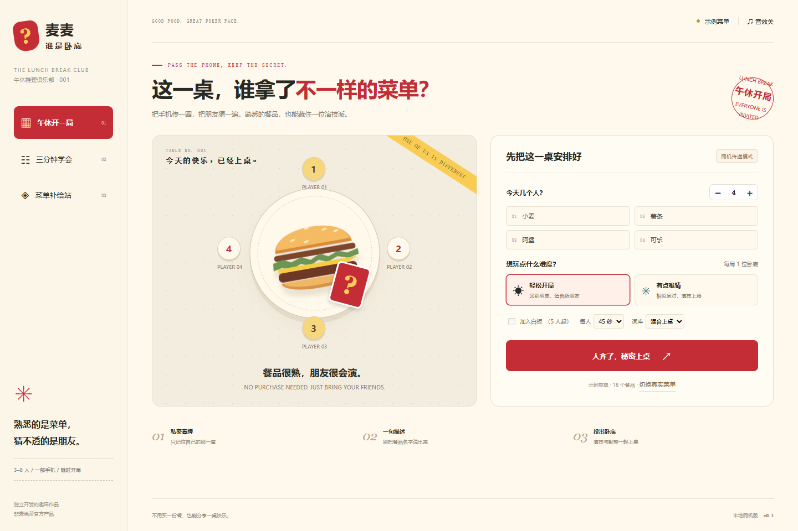

# 麦麦谁是卧底 🍔

**把今天的菜单，变成朋友之间的推理局。** 3～8 人、一部手机：有人拿到一样的餐品，有人拿到相似的另一款。传手机、给线索、投票，找出藏在这一桌的演技派。

面向同事午休、朋友聚会与线下社团。无需购买餐品，没有积分下注、消费任务或官方奖品。本项目是独立开发的趣味作品，非麦当劳官方产品，不暗示官方背书。

## 马上试玩

**在线试玩（演示词库 + 菜单包导入）：<https://mcd-undercover.app.workbuddy.host/>** —— 打开即玩，无需安装；线上为纯静态页，不包含 Token，真实菜单请在本机查询后通过“菜单补给站”导入菜单包。

本机运行需要 Node.js 20.11 或更新版本，**没有第三方依赖，不需要 npm install**。

- Windows：双击根目录 `启动游戏.cmd`，在浏览器打开 `http://127.0.0.1:4317`。
- 命令行：在本目录运行 `npm start`。关闭终端或按 Ctrl+C 停止服务。
- 只运行演示版不需要 Token；演示词库明确标注，不冒充当前在售菜单。
- 要连接真实菜单，双击 `启动真实菜单.cmd`，在本机终端的隐藏输入框中填写 Token。凭证只传给本机进程，不写入文件。然后在网页点“菜单补给站”，输入城市与地点、选择门店。
- 如果端口被占用，先关闭旧的游戏终端；或在 PowerShell 中设置 `$env:PORT='4318'` 再运行 `npm start`，并打开对应端口。



## 一局怎么玩

1. 设置 3～8 个不同昵称，选择难度、餐品分类和发言时间。
2. 把手机交给指定玩家，点开自己的词，看完收起，再交给下一位。除白板外，玩家看不到阵营。
3. 按顺序各描述一句，不直接说完整餐品名。倒计时只提醒，手动交接。可选记下一句金句。
4. 每位存活玩家单独看手机投给另一人；只公开合计票数。最高票出局并揭晓身份，词语留到整局结束再揭晓。
5. 平票时仅在平票候选人中加投一次；再次平票，本轮无人出局，进入下一轮。
6. 卧底阵营全部出局，队员胜。卧底阵营人数达到或超过队员，卧底阵营胜。

可选白板模式至少 5 人：增加一位没有词的玩家，与卧底同阵营，没有单独的猜词复活规则。默认不开白板。

整局结束可下载 PNG 战报、复制文字、再开一局。战报包含身份和餐品词，只应在游戏结束后分享。发言和投票不保存到服务器或浏览器存储，刷新页面会丢失当前对局。

## MCP 如何进入玩法

本机 Node 服务 → 麦当劳官方 `https://mcp.mcd.cn` → 查询门店 → 查询所选门店当前菜单 → 可选匹配官方营养 → 按游戏分类生成词对 → 游戏结束展示来源与已知营养信息。

- 只有当次门店菜单中的可识别单品会进入真实词库，套餐、权益卡与周边不混进餐品词。
- 游戏分类由项目按餐品名称归纳，**不是官方过敏原、配料或口味标签**。
- 轻松模式从相似度较低的候选组抽取，困难模式从较高组抽取。相似度使用名称字符交集；两项都有精确匹配热量时，才加入热量接近程度。
- 营养按名称精确匹配；不猜测杯型、不模糊合并，不匹配或重名歧义时显示未知。
- 不显示价格、不核算消费，不下单、不读历史订单、不领券、不抽奖，不生成健康或运势判断。

详见 [MCP_INTEGRATION.md](MCP_INTEGRATION.md)。真实调用摘要、示例菜单快照和验证边界见 [docs/VALIDATION.md](docs/VALIDATION.md)。

## WorkBuddy 接力开发

用 WorkBuddy 打开**整个项目目录**，让它读取根目录 `SKILL.md`。2026-10-16 已在 WorkBuddy 完成真实 MCP 连接器复测，以及“最近3次成功开局词对防重复”改进，测试由18项增至25项。接力记录见 [workbuddy.md](workbuddy.md)；发布步骤见 [docs/WORKBUDDY_GUIDE.md](docs/WORKBUDDY_GUIDE.md) 第四步。

`workbuddy.md` 分别记录首版归属、WorkBuddy真实工具调用、代码改进及验证边界。首版仍由用户与Codex协作完成，不改称WorkBuddy开发；专项奖励资格以主办方最终审核为准。

## 开发与测试

```powershell
npm test
npm run check
npm start
```

`dist/` 为无构建步骤的浏览器文件，`lib/` 是只读 MCP 客户端与菜单归一化，`server.mjs` 只监听本机，`tests/` 覆盖对局状态机和协议/数据边界。`runtime/` 存放本机查询后生成的脱敏菜单与调用摘要，已被 Git 忽略。

也可使用 WorkBuddy 的原生麦当劳 MCP 连接器查询，把原始菜单 JSON 保存在 `runtime/`，执行：

```powershell
node scripts/import-menu.mjs --menu runtime/raw-menu.json --nutrition runtime/raw-nutrition.json --store "所选门店名称" --out runtime/menu-pack.json
```

随后在网页导入菜单包。营养文件可省略；导入来源始终标注为 `mcp-import`，不会因文件自称实时就显示“本机实时”。

## 当前边界

- 完成的是本地同机游戏，没有远程开房或多人手机同步，也不是防作弊服务；知道如何检查浏览器内存的人可以读取本机状态。
- 本地网页不会收到 Token；没有面向公网开放的凭证代理。
- 官方接口、字段或营业时段可能变化；失败时保留原菜单并明确提示，不伪装成查询成功。
- 菜单为获取时快照，不保证之后仍在售。示例位置为上海人民广场，不是推断用户所在地。
- 已完成本机真实 MCP 查询及WorkBuddy实际接力开发；尚未完成GitHub发布、报名或主办方审核。

代码采用 MIT 许可；官方参赛声明、品牌名称及接口数据的权利归各自权利人，不能据此推断商标授权或商业使用授权。
